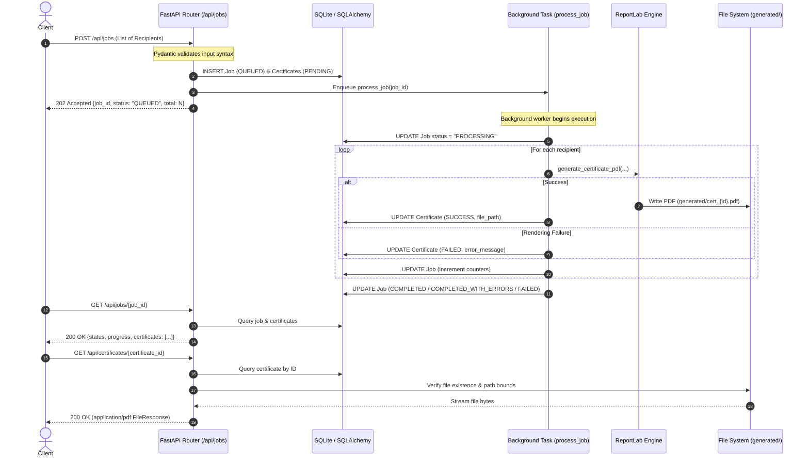

# Bulk Certificate Generator — Interview Preparation Notes

This document provides a concise, technically rigorous reference for explaining the architectural decisions, trade-offs, and implementation details of the Bulk Certificate Generator project during a technical interview.

---

## 1. Problem Statement & Solution

### The Problem
Organizations conducting training, workshops, and hackathons need to generate large batches of customized completion certificates in PDF format.
- Generating dozens or hundreds of vector PDFs within a synchronous HTTP request blocks web worker threads and leads to client timeouts (`HTTP 504`).
- Single-point-of-failure fragility: If one recipient has a corrupted name, invalid characters, or triggers a rendering glitch, a naive batch process terminates prematurely, stranding the remaining valid recipients.
- Lack of visibility: Synchronous APIs cannot provide intermediate progress updates or recipient-level failure diagnostics.

### The Solution
An asynchronous, non-blocking REST API:
1. Validates recipient lists using Pydantic schemas upfront.
2. Persists a generation job and pending certificate rows in a SQLite relational database.
3. Immediately returns a tracking ticket (`HTTP 202 Accepted` with `job_id` and initial status `QUEUED`).
4. Offloads certificate generation to an asynchronous background worker (`FastAPI BackgroundTasks`).
5. Implements per-recipient exception isolation so single rendering errors never fail the complete batch.
6. Updates live percentage progress and per-certificate statuses (`SUCCESS` or `FAILED` with error messages).
7. Exposes endpoints to poll live job progress and retrieve generated PDF files securely.

---

## 2. Architecture & Request Flow

The system employs a clean, layered architecture separating the HTTP transport, validation, business domain, rendering, and persistence layers:

---

## 3. Why FastAPI Was Selected

- **Asynchronous Concurrency**: Built on Starlette and ASGI, natively supporting asynchronous request handling and non-blocking background task scheduling.
- **Built-in BackgroundTasks**: Provides lightweight in-process asynchronous task dispatching without requiring external brokers (Redis/RabbitMQ) for local execution.
- **Automatic Validation & OpenAPI Generation**: Deep integration with Pydantic gives strict request validation, structured error responses (`HTTP 422`), and auto-generated Swagger UI (`/docs`).
- **Developer Velocity**: Minimal boilerplate, standard Python type annotations, and clean dependency injection (`Depends`).

---

## 4. Why SQLite & SQLAlchemy Were Selected

- **SQLite**:
  - Embedded, zero-configuration engine stored as a single file (`certificates.db`).
  - Eliminates external database services (PostgreSQL/MySQL), ensuring the project runs seamlessly on any local development machine out of the box.
  - Configured with `connect_args={"check_same_thread": False}` to allow multiple threads to access connections safely.
- **SQLAlchemy 2.0**:
  - Declarative ORM decouples business logic from low-level SQL syntax.
  - Manages relational constraints, foreign keys (`ondelete="CASCADE"`), and session lifecycles.
  - Enables effortless database migration: switching from SQLite to PostgreSQL in production requires altering only the `DATABASE_URL` connection string.

---

## 5. How Background Processing Works

1. **Dispatching**: When `POST /api/jobs` receives a valid request, it calls `create_job()`, which commits the records on the request-scoped DB session. It then invokes `background_tasks.add_task(process_job, job.id)` and returns `HTTP 202 Accepted` immediately.
2. **Session Independence**: The background function `process_job(job_id)` runs in a separate threadpool worker. It creates its own independent SQLAlchemy session via `SessionLocal()` and closes it inside a `finally` block. This guarantees database sessions are never shared across threads.
3. **Incremental Persistence**: As each certificate is rendered or fails, the worker commits the updated state to SQLite, allowing clients polling `GET /api/jobs/{job_id}` to observe real-time progress.

---

## 6. How the Database Tracks Jobs & Certificates

The schema utilizes two normalized relational tables:

### `generation_jobs` Table
- `id` (UUIDv4 Primary Key, String)
- `status` (`QUEUED`, `PROCESSING`, `COMPLETED`, `COMPLETED_WITH_ERRORS`, `FAILED`)
- `total_count` (Integer)
- `successful_count` (Integer)
- `failed_count` (Integer)
- `created_at` (DateTime UTC)
- `completed_at` (DateTime UTC, nullable)

### `certificates` Table
- `id` (UUIDv4 Primary Key, String)
- `job_id` (UUIDv4 Foreign Key referencing `generation_jobs.id` with `CASCADE` delete)
- `recipient_name` (String, indexed)
- `recipient_email` (String)
- `course` (String)
- `completion_date` (String, ISO `YYYY-MM-DD`)
- `status` (`PENDING`, `SUCCESS`, `FAILED`)
- `file_path` (String, nullable)
- `error_message` (Text, nullable)
- `created_at` (DateTime UTC)

---

## 7. How Progress Is Calculated

Progress is computed dynamically via the `Job.calculate_progress()` model method:

$$\text{Progress} = \max\left(0.0, \min\left(100.0, \text{round}\left(\frac{\text{successful\_count} + \text{failed\_count}}{\text{total\_count}} \times 100, 1\right)\right)\right)$$

### Key Invariants:
- If $\text{total\_count} \le 0$: returns `0.0%`.
- If no recipients processed ($\text{successful} = 0, \text{failed} = 0$): returns `0.0%` (never prematurely shows $100\%$).
- Mathematical clamping ensures progress never goes below $0.0\%$ or exceeds $100.0\%$.

---

## 8. How Partial Failures Are Handled

Resilience in batch processing is achieved through **isolated failure boundaries**:

1. **Per-Item `try...except`**: The generation loop wraps each recipient in its own exception boundary.
2. **Non-Terminating Catch**: If ReportLab encounters a rendering error (e.g., malformed glyph, memory fault), the exception is caught, recorded in `cert.error_message`, the status is set to `FAILED`, and `job.failed_count` is incremented.
3. **Continued Processing**: The loop immediately advances to the next recipient.
4. **Terminal Classification**:
   - $\text{failed\_count} == 0 \implies \text{COMPLETED}$
   - $\text{successful\_count} > 0 \text{ and } \text{failed\_count} > 0 \implies \text{COMPLETED\_WITH\_ERRORS}$
   - $\text{successful\_count} == 0 \text{ and } \text{failed\_count} > 0 \implies \text{FAILED}$
   - Unhandled job-level exception $\implies \text{FAILED}$ (recorded via outer catch with `completed_at` set)

---

## 9. How ReportLab Generates PDFs

The PDF generator (`app/services/certificate_service.py`) uses ReportLab's low-level `canvas.Canvas`:

- **Orientation & Dimensions**: Landscape US Letter ($792 \times 612$ points).
- **Coordinate-Based Drawing**:
  - Double decorative borders: Navy outer (`#0F172A`, 4pt) and Gold inner (`#D97706`, 1.5pt) with corner squares.
  - Verification Seal: Dual concentric rings with "OFFICIAL VERIFIED SEAL" badge.
  - Signatures: Academic Director and Director of Certification signature lines.
- **Dynamic Font Rescaling**:
  - Uses `c.stringWidth()` to measure recipient names and course titles.
  - Dynamically downscales font sizes if the string exceeds allowable page margins (`width - 160`), preventing border clipping.
- **Verification-Ready Streams**: Generated with `pageCompression=0`, enabling raw byte inspection of metadata and text during tests while keeping single-page vector files under 4.5 KB.

---

## 10. How Certificate Retrieval Works & Path Security

Endpoint: `GET /api/certificates/{certificate_id}`

### Flow & Security Safeguards:
1. **Existence Check**: Queries DB for `certificate_id`. If not found $\implies$ `HTTP 404`.
2. **State Checks**:
   - If `status == "FAILED"` $\implies$ `HTTP 400 Bad Request` with the recorded generation failure reason.
   - If `status == "PENDING"` $\implies$ `HTTP 409 Conflict` indicating generation is still in progress.
3. **Disk Existence**: Verifies `os.path.exists(cert.file_path)`. If deleted $\implies$ `HTTP 404`.
4. **Path Traversal Protection**: Resolves the path and validates `cert_path.relative_to(config.GENERATED_DIR.resolve())`. If outside $\implies$ `HTTP 403 Forbidden`.
5. **Header Sanitization**: Sanitizes `cert.recipient_name` before constructing `Content-Disposition: attachment; filename="certificate_{name}_{id}.pdf"`, preventing HTTP header injection.
6. **Streaming**: Returns FastAPI `FileResponse(media_type="application/pdf")`.

---

## 11. How the Application Is Tested

The test suite consists of **28 automated tests** written in `pytest`:

- **In-Memory SQLite with StaticPool**: `sqlite:///:memory:` with `StaticPool` enables cross-session and cross-thread access within tests while maintaining complete isolation from the production database.
- **Temporary File Isolation**: `tmp_path` fixture redirects `config.GENERATED_DIR` to an isolated directory for every test run, preventing file accumulation on disk.
- **Test Categories**:
  1. *Unit Tests*: Pydantic validation (empty lists, invalid emails, blank names, bad dates, malformed JSON).
  2. *Rendering Tests*: Real PDF generation verifying `%PDF-` headers and recipient data in streams.
  3. *Failure Isolation Tests*: Mocking generator failures to verify `COMPLETED_WITH_ERRORS`, all-failed jobs, and continuation past failures.
  4. *Integration Tests*: Full HTTP end-to-end flow from job creation to polling to PDF download.

---

## 12. Current Limitations

> [!IMPORTANT]
> Be transparent about these limitations during an interview to demonstrate senior engineering maturity.

1. **In-Process BackgroundTasks Is Not a Durable Queue**:
   - `FastAPI BackgroundTasks` runs within the FastAPI application process.
   - **No Persistence across Restarts**: If the server crashes or restarts while a job is in `PROCESSING`, the in-memory task is lost. The database record will remain stuck in `PROCESSING` until manually repaired.
   - **No Distributed Workers**: Tasks cannot be distributed across multiple physical machines or worker pools.
2. **Local Storage**:
   - PDFs are stored on the local filesystem (`generated/`). In a containerized or multi-instance cloud environment (e.g. AWS ECS / Kubernetes), files stored on a local container disk cannot be retrieved by another container replica.
3. **SQLite Concurrency Limits**:
   - SQLite uses file-level locking during writes (`database is locked` under high write volume).

---

## 13. How the Design Could Scale to Production

If asked: *"How would you scale this to handle 100,000 certificates per hour?"*:

1. **Distributed Task Queue (Celery / ARQ + Redis / RabbitMQ)**:
   - Replace `BackgroundTasks` with Celery or ARQ.
   - The API endpoint pushes a job payload to a Redis queue and returns `202 Accepted`.
   - Dedicated Celery worker pools consume tasks independently of the web API process.
   - Guarantees durability, retries on transient errors, and process crash recovery.
2. **Cloud Object Storage (AWS S3 / GCP Cloud Storage)**:
   - Rendered PDFs upload directly to S3.
   - Instead of streaming files through the FastAPI server, the certificate retrieval endpoint generates a time-limited **pre-signed S3 download URL**, offloading file I/O bandwidth from the application servers.
3. **Production Database (PostgreSQL)**:
   - Replace SQLite with PostgreSQL managed by connection pooling (e.g., PgBouncer).
   - Allows high-concurrency ACID writes across multiple worker instances.
4. **Horizontal Scaling**:
   - Deploy API instances behind a load balancer (ALB / Nginx).
   - Scale Celery workers horizontally based on queue depth metrics.

---

## 14. Top 10 Likely Interview Questions & Answers

### Q1: Why return `HTTP 202 Accepted` instead of `200 OK` or `201 Created` for job creation?
> **Answer**: In RESTful API design, `202 Accepted` explicitly signals that the request has been accepted for processing, but processing has not been completed. `201 Created` is typically used when the primary resource (the certificates themselves) has already been created. `202 Accepted` sets the correct client expectation for asynchronous workflows.

### Q2: What happens if a worker thread crashes while generating a certificate?
> **Answer**: In this lightweight implementation using `BackgroundTasks`, an unhandled process crash terminates the in-memory task, leaving the database row in `PROCESSING`. In our service, an outer `try...except` catches fatal runtime exceptions and transitions the job to `FAILED`. However, for true crash recovery (e.g. SIGKILL or power outage), a distributed message broker like Celery/RabbitMQ with message acknowledgment (`ack`) and heartbeat tracking is required.

### Q3: How do you prevent SQLite concurrency issues with multiple background threads?
> **Answer**: SQLite connections cannot be shared across threads. We addressed this by:
> 1. Setting `connect_args={"check_same_thread": False}` on the engine.
> 2. Ensuring the background worker calls `SessionLocal()` to instantiate a brand-new, thread-local SQLAlchemy session, closing it explicitly in a `finally` block.

### Q4: Why did you choose ReportLab canvas over HTML-to-PDF converters like WeasyPrint or wkhtmltopdf?
> **Answer**: Tools like WeasyPrint or headless Chrome require heavy external C-libraries, system dependencies, or browser binaries that complicate deployment and consume substantial RAM (100MB+ per render). ReportLab is pure Python/C-accelerated, runs without external system binaries, renders in single-digit milliseconds, and produces compact vector PDFs.

### Q5: How do you protect against path traversal when clients download certificates?
> **Answer**: We enforce three layers of protection:
> 1. Certificate IDs are sanitized using a strict alphanumeric regex (`sanitize_filename`).
> 2. The certificate download endpoint resolves the target file using `Path.resolve()`.
> 3. We verify that the resolved path is a subpath of `config.GENERATED_DIR.resolve()` using `relative_to()`. If an attacker attempts directory traversal, the API immediately aborts with `HTTP 403 Forbidden`.

### Q6: Why did you commit progress to the database after each certificate instead of one big batch commit?
> **Answer**: Committing after each certificate provides real-time observability. A client polling `GET /api/jobs/{id}` sees live progress (e.g. 20%, 40%, 60%) rather than jumping from 0% to 100% at the end. Additionally, if the process is terminated halfway through a batch of 1,000, the work done up to that point is already safely persisted.

### Q7: What distinguishes `COMPLETED` from `COMPLETED_WITH_ERRORS`?
> **Answer**: `COMPLETED` means 100% of the recipients in the batch succeeded (`failed_count == 0`). `COMPLETED_WITH_ERRORS` means the batch finished processing all recipients, but at least one succeeded and at least one failed (`successful_count > 0` and `failed_count > 0`). If all recipients failed, the job transitions to `FAILED`.

### Q8: What would happen if two recipients in the same batch have the exact same email?
> **Answer**: The system generates certificates for both recipients without issue. In real-world educational institutions, one user may legitimately receive multiple certificates for different courses, or two students might share an organizational email address. We did not place a unique constraint on `recipient_email`.

### Q9: How do your automated tests handle the background worker without race conditions?
> **Answer**: FastAPI's `TestClient` (built on Starlette) executes `BackgroundTasks` synchronously right before returning the response. This ensures that assertions against job progress and certificate files run deterministically after the background job finishes, eliminating race conditions and brittle `sleep()` calls in tests.

### Q10: How do you prevent long recipient names from overflowing the certificate borders?
> **Answer**: ReportLab's `canvas.stringWidth()` calculates the exact point width of a string in a given font. In `generate_certificate_pdf()`, we measure the name against the maximum printable width. If it exceeds the boundary, we dynamically step down the font size in a loop (e.g. from 26pt down to 14pt) before rendering, guaranteeing the text remains centered and within the borders.
