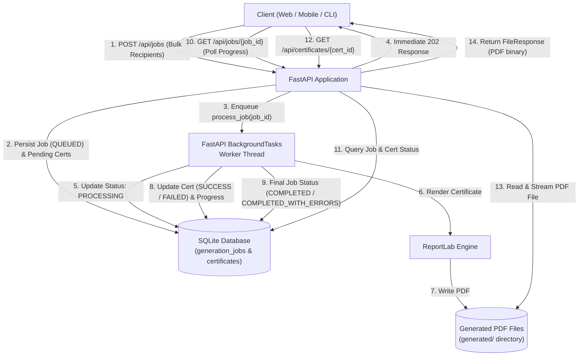

# Bulk Certificate Generator

A high-performance, resilient backend API built with **FastAPI**, **SQLAlchemy**, and **ReportLab** that generates customized completion certificates in bulk asynchronously.

---

## 1. Project Overview

The **Bulk Certificate Generator** is an interview-ready Python backend designed to handle large-scale certificate generation requests efficiently without blocking client requests. Rather than generating PDF certificates synchronously—which causes HTTP request timeouts and server thread starvation—the service accepts bulk recipient lists, queues them as a background job, processes certificates concurrently/asynchronously, and provides real-time progress and health tracking.

---

## 2. Problem Statement

Organizations running courses, workshops, and hackathons need to issue hundreds or thousands of personalized certificates upon completion. Generating hundreds of PDFs in a single HTTP request causes:
- **HTTP Timeouts**: Generating complex vector graphics and typography takes measurable CPU time.
- **Cascading Failures**: A single invalid recipient or corrupted font shouldn't cause the entire batch generation to fail.
- **Resource Starvation**: Unmanaged synchronous processing blocks web worker threads.
- **Lack of Observability**: Clients need visibility into job progress, success counts, and individual recipient failure reasons.

This project solves these issues with asynchronous task dispatching, isolated per-recipient error handling, granular database persistence, and dynamic progress calculation.

---

## 3. Key Features

- **Bulk Asynchronous Processing**: Accepts batches of recipients and immediately returns a job ticket (`QUEUED`), offloading generation to background workers.
- **Fault-Tolerant Partial Failure Isolation**: If a single recipient fails (e.g., rendering crash, malformed edge cases), the remaining recipients continue processing uninterrupted.
- **Comprehensive Status Tracking**: Track batch progress in real-time (`QUEUED` $\rightarrow$ `PROCESSING` $\rightarrow$ `COMPLETED` / `COMPLETED_WITH_ERRORS` / `FAILED`) along with percentage completion.
- **Predefined Professional Certificate Template**: High-resolution landscape PDF certificate designed in pure ReportLab with double borders, gold accents, security seals, and signature lines.
- **Robust Input Validation**: Validates recipient names, RFC-compliant email formats, course titles, and ISO completion dates using Pydantic v2.
- **Path Traversal Protection & Safe File Storage**: Ensures generated files are sanitized and restricted to the designated `generated/` directory.
- **Automated Test Suite**: 100% pass rate across unit, validation, failure isolation, and end-to-end integration tests.

---

## 4. Tech Stack

| Technology | Purpose |
| :--- | :--- |
| **Python 3.10+** | Programming language |
| **FastAPI** | High-performance modern web framework |
| **Uvicorn** | ASGI server for serving the application |
| **SQLAlchemy 2.0** | ORM for clean relational modeling and database transactions |
| **SQLite** | Embedded zero-configuration SQL database engine |
| **Pydantic v2** | Data parsing, schema definition, and validation |
| **ReportLab** | Native vector PDF graphics and layout generation |
| **pytest & HTTPX** | Automated test suite and asynchronous HTTP testing |

---

## 5. System Architecture

### Component Architecture & Data Flow



---

## 6. Project Structure

```
Bulk-Certificate-Generator/
├── app/
│   ├── __init__.py               # App package initialization
│   ├── main.py                   # FastAPI initialization, lifespan, and global exception handlers
│   ├── database.py               # SQLAlchemy database engine and session dependency
│   ├── models.py                 # SQLAlchemy relational models (Job, Certificate)
│   ├── schemas.py                # Pydantic v2 request/response schemas
│   ├── config.py                 # Environment and directory path configurations
│   ├── api/
│   │   ├── __init__.py
│   │   └── routes.py             # REST API endpoint definitions
│   ├── services/
│   │   ├── __init__.py
│   │   ├── certificate_service.py # ReportLab PDF generation logic & security
│   │   └── job_service.py        # Background task processor, DB transactions
│   └── utils/
│       ├── __init__.py
│       └── validation.py         # Custom field validators and path sanitizers
├── templates/
│   └── README.md                 # Certificate styling and layout documentation
├── generated/
│   └── .gitkeep                  # Storage directory for generated PDF certificates
├── tests/
│   ├── __init__.py
│   ├── conftest.py               # In-memory test DB, mocking, and fixtures
│   ├── test_jobs.py              # Tests for job creation, validation, and listing
│   └── test_certificates.py      # Tests for PDF generation, download, and partial failure
├── requirements.txt              # Production and test dependencies
├── .gitignore                    # Git ignore file (excludes DB, venv, generated PDFs)
└── README.md                     # Comprehensive project documentation
```

---

## 7. Setup & Installation Instructions

### Prerequisites
- Python 3.10 or higher
- PowerShell or Bash shell

### Step 1: Clone or Navigate to the Workspace
```powershell
cd e:\Bulk-Certificate-Generator
```

### Step 2: Create and Activate Virtual Environment
On Windows (PowerShell):
```powershell
python -m venv .venv
.\.venv\Scripts\Activate.ps1
```

On Linux / macOS:
```bash
python3 -m venv .venv
source .venv/bin/activate
```

### Step 3: Install Dependencies
```powershell
pip install -r requirements.txt
```

---

## 8. How to Run the Application

Start the local server using Uvicorn:

```powershell
uvicorn app.main:app --host 127.0.0.1 --port 8000 --reload
```

Or execute directly via Python:
```powershell
python -m app.main
```

### Interactive API Documentation
- **Swagger UI**: [http://127.0.0.1:8000/docs](http://127.0.0.1:8000/docs)
- **ReDoc**: [http://127.0.0.1:8000/redoc](http://127.0.0.1:8000/redoc)
- **Health Check**: [http://127.0.0.1:8000/health](http://127.0.0.1:8000/health)

---

## 9. API Endpoint Documentation

### 1. Create Generation Job
- **Method**: `POST`
- **Path**: `/api/jobs`
- **Status Code**: `202 Accepted`
- **Description**: Accepts a list of recipients and queues a background generation task.

#### Request Example:
```json
{
  "recipients": [
    {
      "name": "Rahul Sharma",
      "email": "rahul@example.com",
      "course": "Python Programming",
      "date": "2026-10-09"
    },
    {
      "name": "Ananya Rao",
      "email": "ananya@example.com",
      "course": "Python Programming",
      "date": "2026-10-09"
    }
  ]
}
```

#### Response Example:
```json
{
  "job_id": "fdd4e5eb-aea5-4e21-855b-826fc9e98c29",
  "status": "QUEUED",
  "total": 2
}
```

---

### 2. Check Job Status & Progress
- **Method**: `GET`
- **Path**: `/api/jobs/{job_id}`
- **Status Code**: `200 OK` (or `404 Not Found` if unknown ID)
- **Description**: Returns live progress percentage, counts, and individual recipient statuses.

#### Example Response (Full Success — `COMPLETED`):
```json
{
  "job_id": "fdd4e5eb-aea5-4e21-855b-826fc9e98c29",
  "status": "COMPLETED",
  "total": 2,
  "successful": 2,
  "failed": 0,
  "progress": 100.0,
  "certificates": [
    {
      "certificate_id": "83df9f09-61d4-4062-86ff-a4e73c6311e5",
      "recipient_name": "Rahul Sharma",
      "status": "SUCCESS",
      "error": null
    },
    {
      "certificate_id": "a5998014-15ca-454d-bca3-62d85f63da1d",
      "recipient_name": "Ananya Rao",
      "status": "SUCCESS",
      "error": null
    }
  ]
}
```

#### Example Response (Partial Failure — `COMPLETED_WITH_ERRORS`):
```json
{
  "job_id": "868e6c97-d8c4-4351-a9ab-b92cd980be1b",
  "status": "COMPLETED_WITH_ERRORS",
  "total": 2,
  "successful": 1,
  "failed": 1,
  "progress": 100.0,
  "certificates": [
    {
      "certificate_id": "dfb8ab78-0a17-4a9f-9ecb-3c698b238f99",
      "recipient_name": "Invalid Font User",
      "status": "FAILED",
      "error": "Simulated PDF font rendering crash"
    },
    {
      "certificate_id": "2bbf9dad-5660-4bcf-b719-01b0a575ca79",
      "recipient_name": "Good User",
      "status": "SUCCESS",
      "error": null
    }
  ]
}
```

#### Job Lifecycle States:
- `QUEUED`: Job received and initial records committed.
- `PROCESSING`: Background worker is generating certificates.
- `COMPLETED`: All recipient certificates generated successfully (`failed_count == 0`).
- `COMPLETED_WITH_ERRORS`: Some certificates generated successfully, but one or more failed (`successful_count > 0 and failed_count > 0`).
- `FAILED`: Either all certificates in the batch failed to generate (`successful_count == 0`), or an unexpected fatal system error aborted processing.

---

### 3. Retrieve Certificate PDF
- **Method**: `GET`
- **Path**: `/api/certificates/{certificate_id}`
- **Responses**:
  - `200 OK`: Returns the PDF file with `Content-Type: application/pdf` and `Content-Disposition: attachment`.
  - `400 Bad Request`: Returned if certificate generation failed for this recipient, including the specific error reason.
  - `403 Forbidden`: Returned if path traversal is attempted outside the `generated/` directory.
  - `404 Not Found`: Returned if certificate ID does not exist or file is missing on the server.
  - `409 Conflict`: Returned if certificate generation is still queued or in progress.

#### Curl Example:
```bash
curl -O -J http://127.0.0.1:8000/api/certificates/83df9f09-61d4-4062-86ff-a4e73c6311e5
```

---

### 4. List Recent Jobs (Optional Endpoint)
- **Method**: `GET`
- **Path**: `/api/jobs?limit=50&skip=0`
- **Status Code**: `200 OK`
- **Description**: Returns a paginated list of recent bulk generation jobs.

---

## 10. Partial Failure Handling & Resilience

Bulk processing systems often fail when an unhandled error on record 47 aborts an entire 500-record batch. This service implements **strict failure isolation**:

1. **Per-Recipient Exception Boundaries**: The generator loops through recipients inside an individual `try...except` block.
2. **Individual State Transition**: If a PDF generation fails:
   - Only that certificate is transitioned to `FAILED`.
   - The exact exception reason is saved to `error_message`.
   - `failed_count` is incremented.
   - The loop continues immediately to the next recipient.
3. **Batch Completion Classification**:
   - 0 failures $\rightarrow$ `COMPLETED`
   - $>0$ failures and $\ge 1$ successes $\rightarrow$ `COMPLETED_WITH_ERRORS`
   - All failures ($0$ successes) $\rightarrow$ `FAILED`
   - Unhandled server/database crash $\rightarrow$ `FAILED` (with `completed_at` timestamp recorded)
4. **Immediate Database Synchronization**: The database session commits after every certificate, ensuring polling clients observe live progress rather than waiting for the entire batch to complete.

---

## 11. Automated Testing Instructions

The test suite uses `pytest` and runs against an isolated in-memory SQLite database (`StaticPool`) and isolated temporary file storage.

### Running All Tests:
```powershell
pytest -v
```

### Test Coverage Breakdown (28 Automated Tests):
1. **`test_generate_certificate_pdf_creates_valid_file`**: Validates PDF file creation, non-zero file size, and `%PDF-` header.
2. **`test_certificate_contains_all_required_elements`**: Inspects generated PDF stream bytes to verify recipient name, course name, completion date, and unique certificate ID.
3. **`test_retrieve_unknown_certificate_404`**: Asserts 404 for nonexistent certificate ID.
4. **`test_retrieve_pending_certificate_409`**: Asserts 409 when attempting to download an in-progress certificate.
5. **`test_retrieve_failed_certificate_400`**: Asserts 400 with meaningful error message when downloading a failed certificate.
6. **`test_retrieve_missing_file_on_server_404`**: Asserts 404 when database record exists but disk file is missing.
7. **`test_retrieve_path_traversal_blocked_403`**: Asserts 403 Forbidden if a file path points outside `generated/`.
8. **`test_partial_failure_handling`**: Injects simulated failure for one recipient; asserts remaining certificates succeed, job becomes `COMPLETED_WITH_ERRORS`, and successful PDF is downloadable.
9. **`test_continuation_after_individual_failure`**: Tests 3 recipients where the first fails; asserts the 2nd and 3rd recipients continued processing to completion.
10. **`test_all_certificates_failed_behavior`**: Tests scenario where all recipients fail; asserts job transitions to `FAILED` with accurate counts and errors.
11. **`test_full_integration_flow`**: Complete end-to-end integration flow from `POST /api/jobs` $\rightarrow$ background processing $\rightarrow$ `GET /api/jobs/{id}` $\rightarrow$ `GET /api/certificates/{id}`.
12. **`test_multiple_certificate_failures_in_mixed_batch`**: Tests a 5-recipient batch where multiple (2) certificates fail and 3 succeed; asserts `COMPLETED_WITH_ERRORS`, individual error messages, and successful downloads.
13. **`test_recipient_specific_information_isolation`**: Verifies that generated certificates exclusively contain their corresponding recipient's name and course, preventing cross-recipient data leakage.
14. **`test_progress_bounds_and_edge_cases`**: Validates `calculate_progress` boundaries against negative counts, overflow, and zero total count.
15. **`test_create_job_success`**: Validates 202 response, job ID assignment, and background queueing.
16. **`test_create_job_empty_recipients_validation`**: Rejects empty recipient list with 422.
17. **`test_create_job_invalid_email_validation`**: Rejects invalid email formats with 422.
18. **`test_create_job_empty_name_validation`**: Rejects blank or whitespace names with 422.
19. **`test_create_job_invalid_date_validation`**: Rejects invalid calendar dates with 422.
20. **`test_create_job_missing_fields_validation`**: Rejects payloads missing required recipient fields with 422.
21. **`test_create_job_malformed_json_validation`**: Rejects syntactically malformed JSON with 422.
22. **`test_create_job_invalid_request_types`**: Rejects wrong types (e.g. string instead of list) with 422.
23. **`test_create_job_duplicate_emails_allowed`**: Verifies multiple certificates for the same recipient email are processed without uniqueness collisions.
24. **`test_job_zero_progress_before_processing`**: Verifies newly queued jobs report 0.0% progress, not 100%.
25. **`test_get_job_unknown_returns_404`**: Asserts 404 for unknown job ID.
26. **`test_get_job_status_and_progress`**: Asserts progress calculation, counts, and certificate list.
27. **`test_list_recent_jobs`**: Validates paginated job listing endpoint.
28. **`test_unexpected_fatal_job_level_error`**: Simulates unexpected fatal crash in worker; asserts job is marked `FAILED` rather than stuck in `PROCESSING`.

---

## 12. Database Design & Relational Schema

The persistence layer uses two normalized tables in SQLite, mapped via SQLAlchemy:

### `generation_jobs` Table
| Column | Type | Constraints / Description |
| :--- | :--- | :--- |
| `id` | `String(36)` | Primary Key, UUIDv4 |
| `status` | `String(30)` | Indexed. State: `QUEUED`, `PROCESSING`, `COMPLETED`, `COMPLETED_WITH_ERRORS`, `FAILED` |
| `total_count` | `Integer` | Total number of recipient certificates requested |
| `successful_count`| `Integer` | Count of successfully rendered certificates |
| `failed_count` | `Integer` | Count of certificates that failed rendering |
| `created_at` | `DateTime` | UTC creation timestamp |
| `completed_at` | `DateTime` | Nullable UTC completion timestamp |

### `certificates` Table
| Column | Type | Constraints / Description |
| :--- | :--- | :--- |
| `id` | `String(36)` | Primary Key, UUIDv4 |
| `job_id` | `String(36)` | Foreign Key referencing `generation_jobs.id` with `ondelete="CASCADE"`, Indexed |
| `recipient_name` | `String(255)` | Full recipient name |
| `recipient_email`| `String(255)` | Validated recipient email address |
| `course` | `String(255)` | Course or event title |
| `completion_date`| `String(50)` | ISO completion date (`YYYY-MM-DD`) |
| `status` | `String(30)` | Indexed. State: `PENDING`, `SUCCESS`, `FAILED` |
| `file_path` | `String(500)` | Nullable local filesystem path to generated PDF |
| `error_message` | `Text` | Nullable diagnostic message if generation fails |
| `created_at` | `DateTime` | UTC creation timestamp |

---

## 13. Engineering Design Decisions

### 1. Why FastAPI?
- Native support for asynchronous programming and typing.
- Built-in `BackgroundTasks` enabling clean local asynchronous task execution without external message broker overhead.
- Automatic interactive Swagger documentation and Pydantic schema validation.

### 2. Why SQLite?
- Zero external dependencies; completely self-contained and operates smoothly on any local Windows machine without configuring database servers.
- When paired with `check_same_thread=False` and request-scoped sessions, SQLite easily handles typical single-node background workloads.

### 3. Why SQLAlchemy?
- Provides clean object-relational mapping, declarative relationships, and cascading deletes.
- Decouples database schema definition from low-level SQL syntax, allowing effortless migration from SQLite to PostgreSQL in production.

### 4. Why FastAPI `BackgroundTasks` instead of Celery/Redis?
- Matches the requirements of a lightweight, interview-ready backend.
- Eliminates the operational complexity of managing external Redis instances, Celery workers, and broker connections on local Windows development environments.

### 5. Why ReportLab?
- Industry standard for programmatic vector PDF generation in Python.
- Fast, deterministic, and self-contained; allows sub-millisecond PDF rendering without requiring headless browsers (e.g., Puppeteer/WeasyPrint) or external C-library dependencies.

### 6. Why Per-Certificate Status Tracking?
- Storing individual recipient status records ensures high observability: clients immediately see which recipients succeeded and which failed, enabling granular re-runs without duplicate issuance.

---

## 14. Current Limitations

> [!NOTE]
> These architectural boundaries are intentional for a clean, zero-dependency local backend assignment:

1. **In-Process Task Dispatching**: FastAPI `BackgroundTasks` runs tasks within the web server process. If the server terminates unexpectedly mid-job, pending tasks in memory are not preserved.
2. **Local Storage**: Generated PDFs reside in `generated/`. Multi-node or serverless environments would require cloud object storage (e.g., AWS S3).
3. **Single-Node Write Concurrency**: SQLite employs file-level write locking, making PostgreSQL preferable for high-volume enterprise production workloads.

---

## 15. Future Scope & Production Roadmap

If scaling this system to an enterprise production environment:
1. **Distributed Task Queue**: Replace `BackgroundTasks` with **Celery** or **ARQ** backed by **Redis** or **RabbitMQ** to distribute PDF rendering across multiple worker nodes.
2. **Cloud Object Storage**: Offload PDF storage from the local disk to **AWS S3** or **Google Cloud Storage** with pre-signed download URLs.
3. **Authentication & Authorization**: Add API key authentication, OAuth2/JWT tokens, and role-based access control (RBAC).
4. **Email Delivery Integration**: Add an optional flag in the generation request to dispatch generated certificates directly via SMTP / SendGrid / AWS SES.
5. **Configurable Templates & Dynamic Themes**: Support customizable certificate layouts via JSON configuration or HTML/Jinja templates rendered to PDF.
6. **Job Cancellation & Retry Mechanism**: Allow clients to cancel in-flight jobs or trigger a retry endpoint specifically for failed certificates in a job.
7. **Production Relational Database**: Switch to **PostgreSQL** with connection pooling (e.g., PgBouncer) for high-throughput concurrent writes.

---

## 16. Key Learnings

- **Thread-Safe Asynchronous Database Sessions**: When using FastAPI background tasks with SQLite, ensuring each background worker opens and closes its own independent database session (`SessionLocal()`) is critical to avoid connection sharing issues across worker threads.
- **Resilient Batch Processing Patterns**: Isolating per-item exceptions within a bulk job ensures that an edge case with one recipient does not invalidate progress for hundreds of valid recipients.
- **Deterministic PDF Generation**: Leveraging coordinate-based ReportLab canvas drawing guarantees exact visual reproduction across different operating systems without font rendering divergence.
